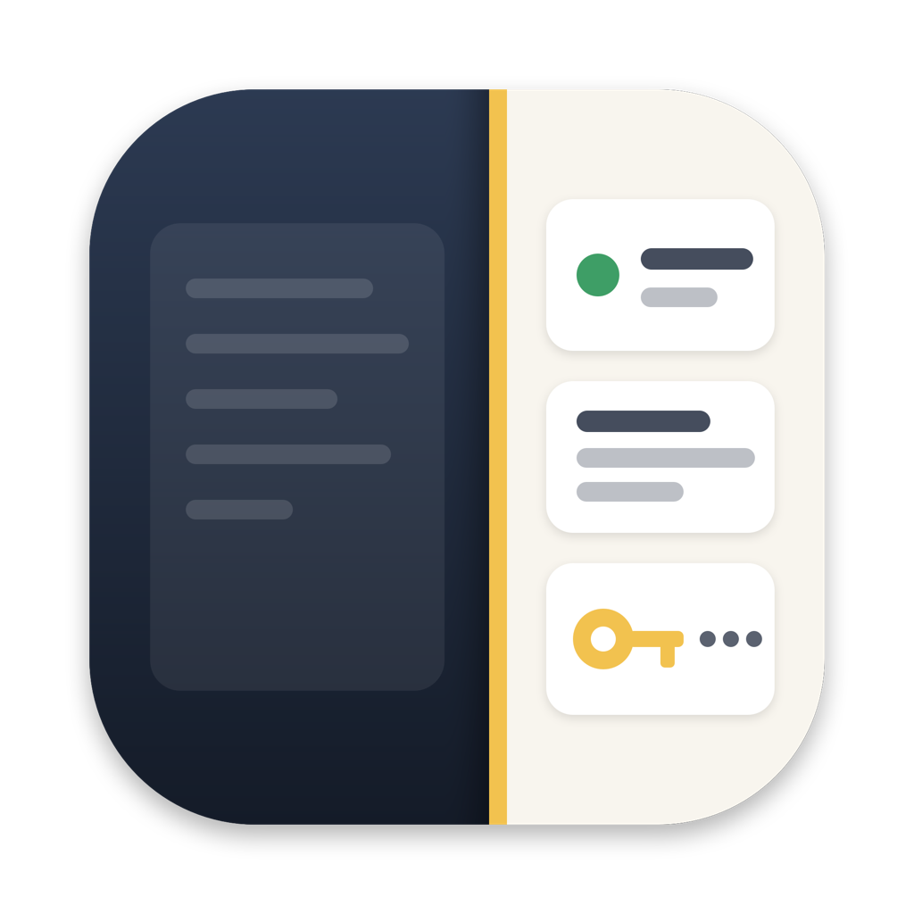
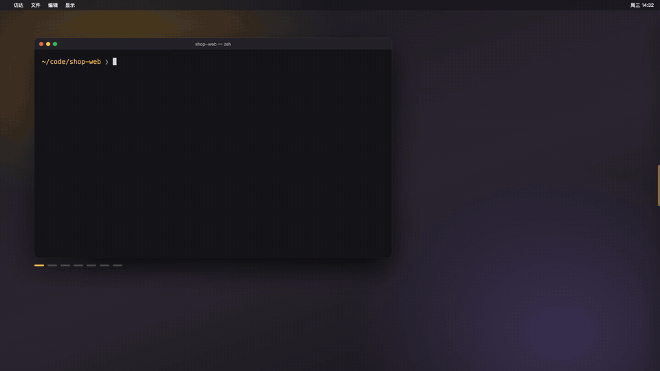
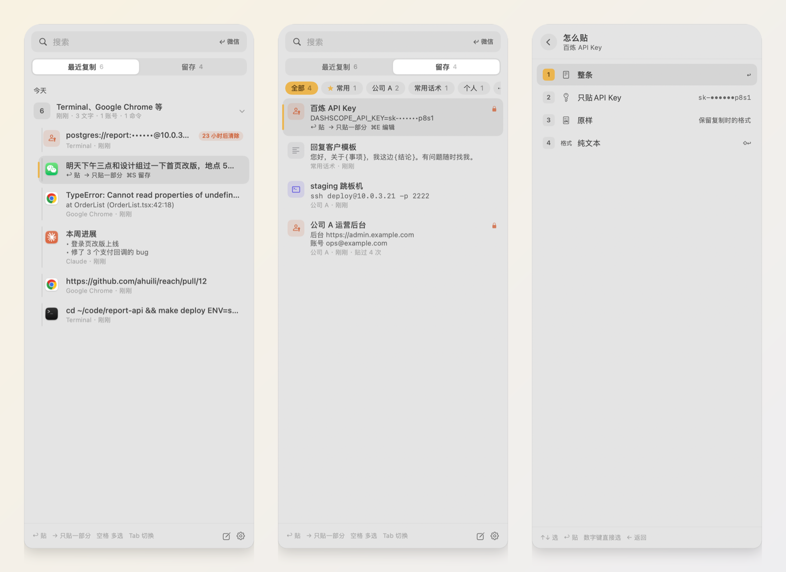

<p align="center">
  
</p>

<h1 align="center">手边 Reach</h1>

<p align="center">
  <b>复制过的、留着备用的、账号密钥，都贴在屏幕边上，伸手就拿。</b><br>
  macOS 侧栏：剪贴板历史 + 随手笔记 + 本机加密的密钥库，看着目标窗口贴；命令行 Agent 也能来查（要你点头）。
</p>

<p align="center">
  <a href="https://github.com/ahuili/reach/releases/latest"></a>
  
  
  <a href="LICENSE"></a>
</p>

<p align="center">
  
  <br>
  <a href="https://github.com/ahuili/reach/raw/main/assets/Reach-intro.mp4">▶ 看完整介绍视频（1 分钟）</a>
</p>

<p align="center">
  
</p>

---

## 它解决什么

- **剪贴板管理器只管"复制过什么"**，笔记 App 只管"留着什么"，账号密码又在第三个地方。要用的时候得想"它在哪"。手边把三样放在同一条侧栏里，一个搜索框搜全部。
- **从 AI 那里复制的东西带着 `**` `##`**，贴进微信一团乱；贴进终端多了个 `$`。手边贴之前先看你要贴给谁，自动换成合适的样子。
- **截图贴不进终端里的 Claude Code、Codex**。手边把截图存成文件、贴路径，Agent 直接能读。
- **Agent 要 API Key 时你只能把密钥贴进对话**。手边让它来申请，你在侧栏点一下，值直接写进项目的 `.env`，不经过对话。

## 功能

**最近复制**
- 自动记下复制的文字、链接、图片、文件，默认留 30 天；按天分段，连着复制的几样自动收成一组。
- 自动认出命令、报错、链接、账号、密钥等类型；截图自动识别文字，可以搜。
- 贴过三次以上的进"常用"，不会过期。

**留存**
- 任意一条按 `⌘S` 留下来；`⌘N` 直接写一条，`⌘E` 编辑。按文件夹放，顶上一排文件夹标签点一下就筛；点最右边的 `⋯` 新建、改名、排序、删除文件夹（删文件夹不删里面的留存）。
- 一键从 SideNotes 搬家（原件不动，重复搬不会多出一份）。
- 留存里写 `{内容}`、`{正式/随意}` 这样的空位，贴的时候先填。

**贴**
- `↩` 贴进你刚才在用的窗口，按目标调整格式：微信、企业微信等聊天窗口去掉 Markdown 记号；邮件、Word 带上标题、加粗、表格；终端去掉行首 `$`，截图变成文件路径。
- `→` 只贴一部分：只贴网址 / 账号 / 密码，纯文本，只贴代码块，合成一行，JSON 排整齐……`⌥↩` 一次填好登录框（账号 ⇥ 密码）。
- **多选**：鼠标移到卡片左边的小方块点一下，或选中后按空格；`⇧` 点击连选，`⌘A` 全选。选好按 `⌘↩` 合成一段贴出去，每段带出处。

**密钥**
- 密码、Key、Token 在本机用规则识别，不经过任何模型；显示时打码，`⌘R` 临时显示，认错了右键"这不是密钥"。
- 整个库逐行加密（AES-GCM），密钥放在系统钥匙串里。
- 复制到的单独密钥 1 小时后从历史清除，夹着密钥的一段文字留一天；贴出去的密钥 30 秒后从剪贴板清除。
- 要把密钥贴进聊天窗口或 AI 对话框时先拦一下，再按一次回车才贴。

**Agent 来查你的库**（命令行 `reach`，或 MCP）

```bash
reach search staging                 # 搜，密钥打码
reach read <id>                      # 读全文，密钥位置是占位
reach recent 5                       # 最近复制的
reach env match DASHSCOPE_API_KEY JINA_API_KEY --project .
reach env write DASHSCOPE_API_KEY JINA_API_KEY --project .   # 你批准后，值直接写进 .env
reach run --env DB_PASS="staging 数据库" -- make migrate      # 你批准后，带着密钥跑一条命令
echo "新账号…" | reach save --title "测试库只读账号" --folder "公司 A"
reach import sidenotes               # 把 SideNotes 的笔记搬进留存
reach status                         # 数量和各项开关（不含内容）
```

凡是会交出密钥、写文件、往库里存东西的，都会在侧栏弹一张卡片等你点。菜单栏图标里可以：连接 Claude Code、连接 Codex（注册成它们的工具，改配置前自动备份）、安装命令行、复制一段给 Agent 的使用说明（贴进 AGENTS.md 就能用，不依赖 MCP）。

**AI（可选）**：设置里填一个 OpenAI 兼容的接口（Ollama 本机模型也行），用来给一组复制起名、留存时自动归文件夹、翻译和精简。发出去之前先在本机把密钥抹掉。不配不影响其他功能。

## 安装

需要 macOS 14 (Sonoma) 或更新，Apple 芯片和 Intel 都支持。

### 方式一：Homebrew（推荐）

```bash
brew install --cask ahuili/tap/reach
```

会顺带把命令行 `reach` 装进 PATH。以后升级：`brew upgrade --cask reach`

### 方式二：一行脚本

```bash
curl -fsSL https://raw.githubusercontent.com/ahuili/reach/main/scripts/install.sh | bash
```

### 方式三：手动下载

在 [Releases](https://github.com/ahuili/reach/releases/latest) 下载 `Reach-版本号.dmg`，拖进「应用程序」。还没有 Apple 公证，第一次打开如果被拦，在终端运行：

```bash
xattr -dr com.apple.quarantine /Applications/Reach.app
```

### 方式四：从源码构建

```bash
git clone https://github.com/ahuili/reach.git && cd reach
scripts/make-cert.sh                      # 建一张本机签名证书（只需一次）
SIGN_IDENTITY="Reach Local Signing" scripts/build-app.sh --install
```

不建证书也能构建，但会用临时签名：每次重新构建后系统都会再问一次钥匙串和辅助功能。离线自测：`swift build --product ReachSelfTest && .build/debug/ReachSelfTest`。

## 第一次打开

1. 菜单栏出现一个侧栏图标；屏幕右边缘有一个小把手。按 `⇧⌘V`（被占用时 `⌃⌥V`）、鼠标滑到把手上、或甩到屏幕右边缘，侧栏就出来了。
2. **允许自动粘贴**：系统设置 › 隐私与安全性 › 辅助功能，打开「手边」。没打开时回车只把内容放上剪贴板，要自己按 `⌘V`。
3. 第一次启动会问一次能不能在钥匙串里存数据库密钥，点「始终允许」。之后启动、升级都不再问。
4. 默认开机自动打开，菜单里可以关。

## 键盘

| 键 | 作用 |
|---|---|
| 直接打字 | 搜索（最近复制和留存一起搜） |
| `↑` `↓` | 选 |
| `↩` | 整条贴进刚才的窗口 |
| `⇧↩` | 原样纯文本 |
| `→` | 只贴一部分（网址、账号、密码…） |
| `⌥↩` | 填登录：账号 → Tab → 密码 |
| `Tab` / `⌘1` `⌘2` | 最近复制 ⇄ 留存 |
| 空格 / `⌘A` | 多选 / 全选，`⌘↩` 合成一段贴 |
| `⌘S` `⌘N` `⌘E` `⌘⌫` | 留存 / 新建 / 编辑 / 删除 |
| `⌘R` `⌘C` | 显示密钥 / 只复制不贴 |
| `Esc` | 一层层退出 |

## 隐私

- 所有数据只在本机，`~/Library/Application Support/Reach/`，逐行加密。
- 不联网，除非你在设置里配了 AI 接口；发给 AI 的内容先在本机抹掉密钥。
- 密码管理器（1Password 等）标记为"不要记录"的复制，手边不记。
- 截图贴进终端时会在 `~/Library/Caches/Reach/shots/` 存一份临时 PNG（只有你能读，一天后删）。

## 边界和已知问题

- **密钥交给 Agent 之后它就读得到。** 写进 `.env` 的值、`reach run` 注入的环境变量，Agent 都有办法读出来。手边管的是：没你允许拿不到、给了谁有记录可查的入口、默认不出现在对话文字里。
- **"普通 ⌘V 也按目标窗口调整格式"默认关**：它会在你切到聊天窗口时改写剪贴板。从手边里贴不受影响。
- Agent 进展栏（显示 Claude Code、Codex 在跑的会话）在重新设计，默认关，设置里能打开。
- 还没有 iCloud 同步、手机端，没有 Apple 公证。

## 结构

```
Sources/ReachCore     加密存储、密钥识别、内容分类、Markdown 转换、配置匹配、Agent 会话解析、进程间通信、SideNotes 导入
Sources/Reach         App：剪贴板监听、粘贴、侧栏界面、屏幕边把手、批准流程、自动整理、设置
Sources/reachctl      命令行和 MCP 服务（打包在 Reach.app/Contents/MacOS/reachctl，装到 PATH 时叫 reach）
Sources/ReachSelfTest 自测（CommandLineTools 没有 XCTest）
promo/                介绍视频：真实的侧栏截图（测试模式 + 演示数据）+ 示意桌面，逐帧渲染
scripts/              build-app.sh 构建，release.sh 打包发布，install.sh 一行安装，make-cert.sh 建签名证书，make-icon.swift 画图标
```

测试时设 `REACH_HOME=<目录> REACH_KEYFILE=1` 可以让它用临时目录和文件密钥，不碰真实数据、剪贴板和快捷键。

原名「页边 Margin」，从旧版升级会自动把数据搬过来。

## 许可

MIT
